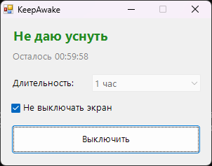

<div align="center">

# ☕ KeepAwake

**Не даёт Windows уснуть: для загрузок, рендера, презентаций и долгих сборок**




</div>

## ✨ Возможности

- 🛌 Блокирует спящий режим, пока включён. Никакого «дёргания мыши», используется официальный API Windows (`SetThreadExecutionState`)
- 🖥️ По желанию не даёт гаснуть экрану
- ⏱️ Таймер: 15 минут, 30 минут, 1, 2, 4 или 8 часов, либо бессрочно
- 📥 Сворачивается в трей, управляется правой кнопкой по иконке
- 🔁 После выключения или закрытия программы настройки питания сразу возвращаются как были

## 💡 Когда пригодится

- Качаешь большой файл или игру
- Рендеришь видео или компилируешь проект
- Показываешь презентацию или смотришь лекцию

## 📥 Установка

1. Скачай `KeepAwake.exe` из раздела [**Releases**](../../releases/latest)
2. Запусти его, установка не нужна

## 🛠️ Сборка из исходников

Нужен только Windows: компилятор C# входит в состав .NET Framework.

```bat
build.bat
```

## 📄 Лицензия

[MIT](LICENSE)
